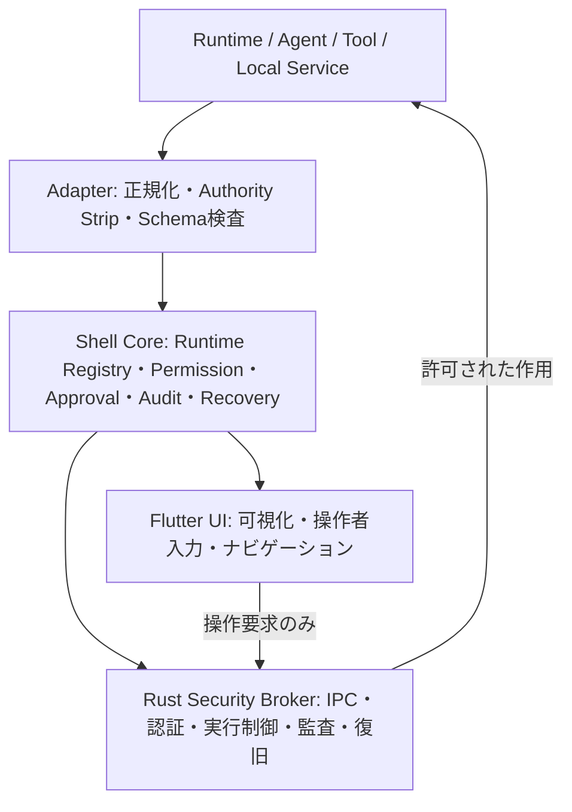

# 🐚 D4 Pocket
### AIエージェントが使うソフトウェアの「操作・権限・責任」を、基盤からつくる。

**D4 Pocketは、複数のAIエージェント・Runtime・Toolを、一つの操作面と検証可能な責任構造で扱うための汎用基盤です。**

AIエージェントが高度になるほど、次に難しくなるのは「何ができるか」だけではありません。**何を接続し、誰の権限で動かし、どの状態を信頼し、失敗したらどう復旧するか。** D4 Pocketは、その制御を個別アプリの場当たり的な実装から切り離します。

名前のとおり目指すのは、異なる能力やRuntimeを必要に応じて取り出し、安全に組み合わせられる**エージェントのための四次元ポケット**。特定のLLMやBLUE-TANUKI専用のフロントエンドではありません。

[開発状況](docs/REV5_PRODUCT_PROGRESS.md) · [クイックスタート](QUICKSTART.md) · [アーキテクチャ仕様](docs/specs/gui-shell-spec-v1.md) · [責任境界](CLAIM.md) · [エージェント向け開発規則](AGENTS.md)

> **開発中 — 製品リリース未宣言。** Windowsは機能実装の到達点を持ち、macOS・Android・iOSでも限定的な製品受入の証拠があります。一方、統合工程B4、正式配布・実機保証・最終QAは未完了です。2026年10月11日の観測を下の表に示します。

## D4 Pocketが変えようとしていること

| 従来生じやすい課題 | D4 Pocketの設計 |
|---|---|
| エージェントごとに実行・権限・承認の仕組みがばらつく | **RuntimeをまたぐContractとControl Plane**を共通化 |
| UIや外部Adapterが権限を事実上決めてしまう | **Flutterは表示と要求、Rust Brokerは権限に関わる本番境界**に限定 |
| 失敗時に「何が起きたか」が追えない | **Permission → Approval → Audit → Recovery**を構造的に関連付ける |
| LLMに開発を任せると接続規則が曖昧になる | **LLM-readableなSchemaとConformance**で、実装の接続面を先に固定 |
| Runtime・Toolごとに操作画面をつくり直す | **Adapter境界**を通じて異種Runtimeを統合する |

核心は、**LLMを開発・統合の第一級コンシューマとして扱いながら、決して権限源にはしない**ことです。LLM出力、記憶、Tool結果、Adapter metadata、GUI stateだけでPermissionを生成・昇格させません。

## 現在の到達点

2026年10月11日までに記録された、対象と環境を限定した実装・検査の状態です。**工程のCLOSEDは正式な製品出荷の意味ではありません。**

| 対象 | 現行の状態 | 成立していない範囲 |
|---|---|---|
| **Windows Desktop** | rev5のWindows側P12、Feature Completeの開発到達点 | installed-path最終証拠、正式Release、owner GO |
| **Agent Compare / Handoff** | P2 Multi-Agent Compare、P3 Agent HandoffのProduct Build受入CLOSED | すべての実Agent・実環境での一般保証 |
| **Mobile / Non-Windows** | P13の有限Product Build受入は2026-10-09にCLOSED。Android Emulator・iOS Simulator等の限定証拠を保持 | 物理端末保証、OS別の正式配布・署名・identity |
| **緩衝基盤とAgent Task** | B0〜B3はCLOSED。B4-L2で実Codex CLI結果、調停記録、AuditとAgent Centerのhash-only投影まで局所接続 | **Windows Desktop IPC → Broker → 実Codex → Agent Center**の単一製品経路。B4全体はOPEN |
| **正式な出荷判断** | Release GateとOwner承認を独立に保持 | <code>task_execution=unsupported</code>、<code>release_ready=false</code> |

B4-L2の記録済み検査では、Rust全体直列テスト **569 passed / 0 failed / 13 ignored**、Agent Task Flutter client 14件とAgent Center widget 1件、Schema **167件**・正常例 **163件**・否定fixture **215件**、Conformance **245 checks**を確認しています。これは**2026-10-11の開発環境における対象版の証拠**であり、このREADME更新時に再実行した値でも、インストール済み製品の保証でもありません。[観測範囲と残差](docs/REV5_PRODUCT_PROGRESS.md)を参照してください。

## アーキテクチャ — 誰が何を決めるのか



- **Flutter / Dart：** 交換可能な製品UI。権限の意味・秘密・最終承認を所有しません。
- **Rust：** authority-sensitiveな製品境界。IPC、署名、Approval eligibility、Audit、Recovery、command gatingを扱います。
- **Python：** 現行のShell Core参照実装と開発・検証系。最終的なinstalled-productのPython依存を前提にしません。
- **JSON Schema / Conformance：** Runtime、Adapter、Tool、Permission、Agent Task等の接続契約と否定試験を担います。
- **TypeScript / Node：** SDK・Adapter・Protocol client・Bridgeの補助面であり、Core Runtimeにしません。

接続するRuntimeの第一候補は[BLUE-TANUKI](https://github.com/gatchimuchio/BLUE-TANUKI)です。ただし、**D4 PocketはBLUE-TANUKI専用GUIではなく、Adapterを介する汎用Runtime基盤**です。

### 内容露出・承認・監査の原則

内容露出の5段階（<code>none</code>、<code>hash_only</code>、<code>summary</code>、<code>redacted</code>、<code>full</code>）を区別し、本文全体は<code>full</code>が許可されたときだけ表示できます。

権限に関わる作用は、原則として **Capability → Permission → Approval state → AuditEvent → RecoveryAction** の責任関係へ対応付けます。Schemaの存在だけでは実行可能な製品機能の成立を主張しません。[拡張面の設計標準](docs/standards/llm-readable-extension-surface.md)と[セキュリティ方針](SECURITY.md)を参照してください。

## 試す・検証する

まず、FlutterやRustを導入しなくても実施できるContract・Conformanceの開発用検査から始められます。

```bash
python tooling/schema_check/check_schemas.py
python tooling/conformance_tests/run_conformance_skeleton.py
```

必要に応じてRust・Flutterの製品実装を別途検査します。

```bash
cd native/rust_helper && cargo test
cd apps/desktop_flutter && flutter analyze
```

これらは**ソースからの開発・検証手順**であり、正式インストーラーの案内ではありません。環境差と既知の未解決検査は[現行進捗](docs/REV5_PRODUCT_PROGRESS.md)を正本とし、未実施テストをPASSと報告しません。[詳しい手順](QUICKSTART.md)を参照してください。

## リポジトリを読む

| 場所 | 主な責任 |
|---|---|
| [`specs/`](specs/) | Contract Schemaと各種機能境界 |
| [`packages/shell_core/`](packages/shell_core/) | Framework非依存のShell Core参照実装 |
| [`native/rust_helper/`](native/rust_helper/) | Rust Security Brokerと認証された作用経路 |
| [`apps/desktop_flutter/`](apps/desktop_flutter/) | Desktop Flutter UI |
| [`apps/mobile_flutter/`](apps/mobile_flutter/) | Android / iOSのUI製品面 |
| [`tooling/`](tooling/) | Schema・Conformance・release検証 |
| [`docs/`](docs/) | 契約、工程、証拠、未成立条件 |

開発に参加するAIエージェントは最初に[AGENTS.md](AGENTS.md)を読み、変更対象のContract、利用するProduction path、否定試験、安全境界を特定してください。作業・検査・Git運用はリポジトリ固有のQE規律に従います。

## 技術的な主張とリリースの境界

D4 Pocketの狙いは、**AIエージェントの実装・統合に必要な「責任基盤」そのものを提供すること**です。個々の機能デモだけでなく、後から実装を増やしても権限と安全の意味が崩れない構造を重視しています。

ただし、現在のSchema・fixture・局所実機試験は、あらゆる外部Agentとの相互運用性、installed-productの安全保証、公開配布準備完了、第三者環境での同等性能を証明しません。**公開製品としての完成判定は、Release Gateの証拠とHuman ownerの独立GOを必要とします。**

詳細：[製品主張境界](CLAIM.md) · [リリース検査](RELEASE_CHECKLIST.md) · [Final QA Queue](docs/FINAL_QA_QUEUE.md) · [工程・履歴](ROADMAP.md) · [検証記録](VALIDATION.txt) · [互換境界](COMPATIBILITY_MATRIX.md)。

## ライセンス

成果物の種類ごとにライセンスを分離しています。任意選択のデュアルライセンスではありません。

- **ソースコード・実装・試験・ツール：** [Apache License 2.0](LICENSE-APACHE-2.0)
- **仕様・設計・READMEを含む文書：** [Creative Commons Attribution 4.0 International](LICENSE-CC-BY-4.0)
- 適用範囲と第三者由来物：[LICENSE](LICENSE) · [NOTICE](NOTICE)

---
**D4 Pocket — AIエージェントが「できること」の先に、「責任を持って使えること」を実装する。**
