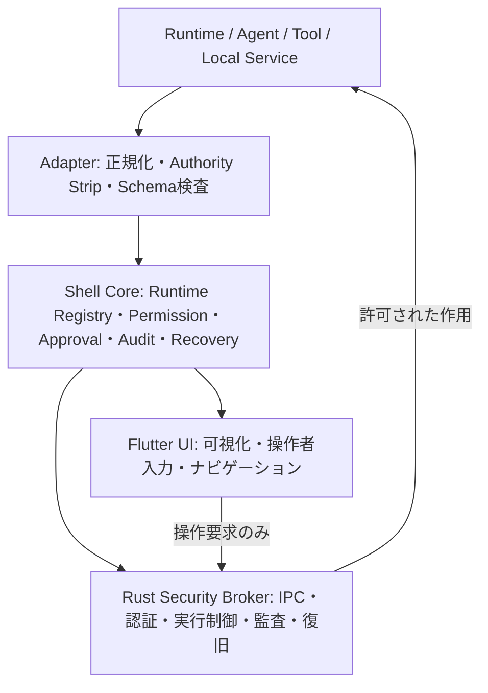

# 🐚 D4 Pocket
### AIエージェントが使うソフトウェアの「操作・権限・責任」を、基盤からつくる。

**D4 Pocketは、複数のAIエージェント・Runtime・Toolを、一つの操作面と検証可能な責任構造で扱うための汎用基盤です。**

AIエージェントが高度になるほど、次に難しくなるのは「何ができるか」だけではありません。**何を接続し、誰の権限で動かし、どの状態を信頼し、失敗したらどう復旧するか。** D4 Pocketは、その制御を個別アプリの場当たり的な実装から切り離します。

名前のとおり目指すのは、異なる能力やRuntimeを必要に応じて取り出し、安全に組み合わせられる**エージェントのための四次元ポケット**。特定のLLMやBLUE-TANUKI専用のフロントエンドではありません。

[現行工程・進捗 v5](docs/QE_2026-11-14/進捗.md) · [v5採用記録](docs/QE_2026-11-14/採用記録.md) · [v5施工指示書](docs/QE_2026-11-14/03_D4Pocket_CODEX_v5_JA.md) · [rev5受入れ履歴](docs/REV5_PRODUCT_PROGRESS.md) · [クイックスタート](QUICKSTART.md) · [アーキテクチャ仕様](docs/specs/gui-shell-spec-v1.md) · [責任境界](CLAIM.md) · [エージェント向け開発規則](AGENTS.md)

> **開発中 — 製品リリース未宣言。** 現行正本は[2026-11-14統合製品3点 v5](docs/QE_2026-11-14/採用記録.md)です。E0は着工に必要な4出力に限定し、製品A〜J全躯体の実Source一巡→全Consumer接続→全数監査→統合QC→OS別QAの順に施工します。W00〜W08は受入座標で施工順の待機列ではありません。W00=SCOPED_PASS、W01=CLOSED（Windows normal Release／Codex CLI限定）、W02=OPEN。旧局所PASSはv5の別OS・別候補の受入れへ自動転記しません。Linux nativeを含む五OSは必須製品対象。一般使用者は各OS対応インストーラーを取得・導入してサービス利用できる体験を目標とし、Windows所有実機で完成品を最終確認、他OSは宣言標準仮想環境で検証します。OS別installed製品QAは未成立。`release_ready=false`、18件中16件のRelease Blocker未解決、正式Q0〜Q7=DEFERREDです。過去の範囲は[v4進捗](docs/QE_2026-11-13/進捗.md)、[v3進捗](docs/QE_2026-11-09/進捗.md)と[rev5履歴](docs/REV5_PRODUCT_PROGRESS.md)を参照してください。

## D4 Pocketが変えようとしていること

| 従来生じやすい課題 | D4 Pocketの設計 |
|---|---|
| エージェントごとに実行・権限・承認の仕組みがばらつく | **RuntimeをまたぐContractとControl Plane**を共通化 |
| UIや外部Adapterが権限を事実上決めてしまう | **Flutterは表示と要求、Rust Brokerは権限に関わる本番境界**に限定 |
| 失敗時に「何が起きたか」が追えない | **Permission → Approval → Audit → Recovery**を構造的に関連付ける |
| LLMに開発を任せると接続規則が曖昧になる | **LLM-readableなSchemaとConformance**で、実装の接続面を先に固定 |
| Runtime・Toolごとに操作画面をつくり直す | **Adapter境界**を通じて異種Runtimeを統合する |

核心は、**LLMを開発・統合の第一級コンシューマとして扱いながら、決して権限源にはしない**ことです。LLM出力、記憶、Tool結果、Adapter metadata、GUI stateだけでPermissionを生成・昇格させません。

## 現在の到達点

2026年11月10日時点で照合した、対象と環境を限定した実装・検査の状態です。各証拠は実行時の対象ソースcommitへ結合し、現在のmainを再試験した結果へ付け替えません。**工程のCLOSEDは正式な製品出荷の意味ではありません。**

| 対象 | 現行の状態 | 成立していない範囲 |
|---|---|---|
| **Windowsデスクトップ版** | W01/G1をWindows normal Release／Codex CLI限定でCLOSED。Windowsの`task_execution=supported`を確認 | W02/G2、正式installed lifecycle、他Runtimeとの統合、正式Release、owner GO。Linuxの能力状態は下記のLinux欄を参照 |
| **Agent比較／引継ぎ** | P2複数Agent比較、P3 Agent引継ぎのProduct Build受入CLOSED | すべての実Agent・実環境での一般保証 |
| **モバイル（Android／iOS）** | v4の標準Emulator／Simulatorでinstalled製品を検証する対象 | v4候補のinstalled QA、正式配布・署名・identity。過去P13証拠はその時点の履歴 |
| **Linuxデスクトップ版** | 完全対応が必須。既存のWorkspace、Agent Task／Recovery、provenance、MCP Credential、archive、Wayland、Setup lifecycleの限定受入れを保持。run #282でLinux normal Release build、run #283でinstalled GTK UIからTask完了・cancel・deadline／process／scratch supervisionを限定PASS。Linux normal Release／Codex CLIの`task_execution=supported`を確認 | #283は`r2-e2e` test build・Ubuntu 22.04.5 Xvfb／X11・loopback fixture。normal Release installed Task、実Provider、実desktop／全compositor、残る必須consumer、正式配布・署名は未受入れ。`linux_native_product_support=unresolved` |
| **緩衝基盤とAgent Task** | B0〜B4は有限受入れCLOSED、B5はOPEN。#54の3回PASSは履歴として保持。後続#55（source `1e57a828`）はRust全target 572成功／0失敗／13除外の一方、capture判定でworkflow FAIL。後続Broker build／IPC smokeはSKIP。`BUF-T04`部分観測、`BUF-T05`／`BUF-T06`OPEN、`BUF-T23`局所PASS。詳細は[B5記録](docs/緩衝基盤_rev5補遺_QC/B5_自己適用.md) | OneDrive警告との因果、loopback/TLS failureの根因、Q4の長期／反復／資源影響、現行SAC policy全体、通常Release installed Taskの一気通貫証拠、正式配布・実機保証 |
| **正式な出荷判断** | Release GateとOwner判断を独立に保持。W02〜W08は未成立 | Linuxを含むnormal Release能力の限定成立は製品全体のrelease readinessを意味しない。正式署名／配布と残存必須条件は未成立。`release_ready=false`、16 Blocker unresolved |

- 項目: Linux native製品の全面対応
  classification: `release_blocker`
  registry_id: linux_native_product_support
  reason: Linux native Desktopは必須製品対象。Linux normal Release／Codex CLIの`task_execution=supported`と、installed GTK上のTask process／scratch supervisionは限定確認済みだが、normal Release installed Task、実Provider、全compositor／必須consumer、正式配布を含むLinux製品全体は未受入れである。
  required_action: 受入れ済み範囲を再試験せず、normal Release installed Task、実desktop/compositor、残る必須consumer、正式Installer／update／rollback／uninstall／署名配布を進め、Linux native全体の製品受入れを成立させる。

B4-L2の記録済み検査では、Rust全体直列テスト **569 passed / 0 failed / 13 ignored**、Agent Task Flutter client 14件とAgent Center widget 1件、Schema **167件**・正常例 **163件**・否定fixture **215件**、Conformance **245 checks**を確認しています。これらは**2026-10-11の開発環境における対象版の証拠**であり、このREADME更新時に再実行した値でも、インストール済み製品の保証でもありません。10月17日のB4統合経路証拠も`r2-e2e` staged buildとlocalhost合成APIの範囲に限られ、通常Release能力やinstalled provenanceを示しません。[観測範囲と残差](docs/REV5_PRODUCT_PROGRESS.md)を参照してください。

## アーキテクチャ — 誰が何を決めるのか



- **Flutter / Dart：** 交換可能な製品UI。権限の意味・秘密・最終承認を所有しません。
- **Rust：** authority-sensitiveな製品境界。IPC、署名、Approval eligibility、Audit、Recovery、command gatingを扱います。
- **Python：** 現行のShell Core参照実装と開発・検証系。最終的なinstalled-productのPython依存を前提にしません。
- **JSON Schema / Conformance：** Runtime、Adapter、Tool、Permission、Agent Task等の接続契約と否定試験を担います。
- **TypeScript / Node：** SDK・Adapter・Protocol client・Bridgeの補助面であり、Core Runtimeにしません。

接続するRuntimeの第一候補は[BLUE-TANUKI](https://github.com/gatchimuchio/BLUE-TANUKI)です。ただし、**D4 PocketはBLUE-TANUKI専用GUIではなく、Adapterを介する汎用Runtime基盤**です。

### 内容露出・承認・監査の原則

内容露出の5段階（<code>none</code>、<code>hash_only</code>、<code>summary</code>、<code>redacted</code>、<code>full</code>）を区別し、本文全体は<code>full</code>が許可されたときだけ表示できます。

権限に関わる作用は、原則として **Capability → Permission → Approval state → AuditEvent → RecoveryAction** の責任関係へ対応付けます。Schemaの存在だけでは実行可能な製品機能の成立を主張しません。[拡張面の設計標準](docs/standards/llm-readable-extension-surface.md)と[セキュリティ方針](SECURITY.md)を参照してください。

## 試す・検証する

まず、FlutterやRustを導入しなくても実施できるContract・Conformanceの開発用検査から始められます。

```bash
python tooling/schema_check/check_schemas.py
python tooling/conformance_tests/run_conformance_skeleton.py
```

必要に応じてRust・Flutterの製品実装を別途検査します。

```bash
python -X utf8 tooling/run_cargo_isolated.py test --locked --offline --manifest-path native/rust_helper/Cargo.toml
python tooling/validate_all.py --flutter-step desktop_flutter_analyze --desktop-platform windows
```

`run_cargo_isolated.py`はCargoの生成targetをRepository／OneDrive外の一時領域へ設定し、終了時に回収します。明示的な`--target-dir`とCargo `--config`は隔離を迂回し得るため拒否します。これはCargo targetの配置境界であり、`build.rs`等が別pathへ書く動作やCargo package cache全体をsandboxするものではありません。

`--flutter-step`は指定したFlutter analyze／test／buildだけをOneDrive外の一時source snapshotで実行します。Owner用起動scriptも`tooling/launch_owner_desktop_isolated.py`を介し、Rust helper build、Flutter run、一時session fileを隔離snapshot内で扱います。任意に直接実行する`flutter run`等はこの隔離経路を通りません。snapshotは生成物を隔離する開発用機構で、Rust BrokerのAuthorityを代替しません。Broker永続storeは既存の開発データ互換性のため従来locationを維持します。

これらは**ソースからの開発・検証手順**であり、正式インストーラーの案内ではありません。環境差と既知の未解決検査は[現行進捗](docs/REV5_PRODUCT_PROGRESS.md)を正本とし、未実施テストをPASSと報告しません。[詳しい手順](QUICKSTART.md)を参照してください。

## リポジトリを読む

| 場所 | 主な責任 |
|---|---|
| [`specs/`](specs/) | Contract Schemaと各種機能境界 |
| [`packages/shell_core/`](packages/shell_core/) | Framework非依存のShell Core参照実装 |
| [`native/rust_helper/`](native/rust_helper/) | Rust Security Brokerと認証された作用経路 |
| [`apps/desktop_flutter/`](apps/desktop_flutter/) | デスクトップ向けFlutter UI |
| [`apps/mobile_flutter/`](apps/mobile_flutter/) | Android / iOSのUI製品面 |
| [`tooling/`](tooling/) | Schema・Conformance・release検証 |
| [`docs/`](docs/) | 契約、工程、証拠、未成立条件 |

開発に参加するAIエージェントは最初に[AGENTS.md](AGENTS.md)を読み、変更対象のContract、利用するProduction path、否定試験、安全境界を特定してください。作業・検査・Git運用はリポジトリ固有のQE規律に従います。

## 技術的な主張とリリースの境界

D4 Pocketの狙いは、**AIエージェントの実装・統合に必要な「責任基盤」そのものを提供すること**です。個々の機能デモだけでなく、後から実装を増やしても権限と安全の意味が崩れない構造を重視しています。

ただし、現在のSchema・fixture・局所実機試験は、あらゆる外部Agentとの相互運用性、installed-productの安全保証、公開配布準備完了、第三者環境での同等性能を証明しません。**公開製品としての完成判定は、Release Gateの証拠とHuman ownerの独立GOを必要とします。**

詳細：[製品主張境界](CLAIM.md) · [リリース検査](RELEASE_CHECKLIST.md) · [Final QA Queue](docs/FINAL_QA_QUEUE.md) · [工程・履歴](ROADMAP.md) · [検証記録](VALIDATION.txt) · [互換境界](COMPATIBILITY_MATRIX.md)。

## ライセンス

成果物の種類ごとにライセンスを分離しています。任意選択のデュアルライセンスではありません。

- **ソースコード・実装・試験・ツール：** [Apache License 2.0](LICENSE-APACHE-2.0)
- **仕様・設計・READMEを含む文書：** [Creative Commons Attribution 4.0 International](LICENSE-CC-BY-4.0)
- 適用範囲と第三者由来物：[LICENSE](LICENSE) · [NOTICE](NOTICE)

---
**D4 Pocket — AIエージェントが「できること」の先に、「責任を持って使えること」を実装する。**
